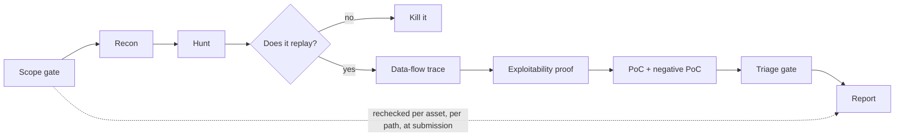

<div align="center">

[](https://git.io/typing-svg)

</div>

I break web apps, APIs, mobile apps and open-source code for a living, then write it up so the fix is obvious and the proof is boring: one request, one response, one timestamp.

Most of my work sits under NDAs and private programs, so this profile shows how I work rather than a trophy list. When a disclosure goes public I link it here. Not before.

## What I do

| Surface | What that actually means |
|---|---|
| **Web and API** | Auth, session and business-logic depth first. IDOR, mass assignment, SSO and JWT flows, GraphQL, race conditions. |
| **Mobile** | Android and iOS static plus runtime work. Frida, unpinning, and decompiling Flutter/Dart AOT builds with blutter when the logic isn't in the Java layer. |
| **Source review** | Open-source maintainers' code, read file by file, with PoCs run against the real build. Private advisories, coordinated disclosure. |
| **Internal VAPT** | Checklist-driven engagements for an enterprise app portfolio: scope, test, report, retest, sign-off. |
| **Reverse engineering** | Ghidra for binaries, jadx and blutter for apps. |

## How a finding gets made



Scope is checked three times, not once: per asset, per path, and again at the moment of submission. A host that was in scope on Monday is not automatically in scope on Friday.

## Rules I learned the hard way

<details>
<summary><b>Open the case notes</b></summary>

<br>

1. **A negative from a rebuilt request means nothing.** If I reconstruct an API call by hand and it fails, that proves my copy is wrong, not that the server is safe. I re-check in a real browser session before writing anything off.
2. **The UI lies in both directions.** A rich-text editor can escape my payload on screen while the raw POST body still stores it. I test the transport, not the widget.
3. **"Confirmed" is a claim until there's an artifact.** That goes double for anything produced by an automated agent. A subagent once reported a stored XSS that turned out to be its own DOM write. Now every verdict needs a saved request, response, and screenshot I've opened myself.
4. **Clean means every file was read.** I don't mark a repository clean on partial coverage, and I don't count a methodology document as proof I tested something.
5. **Bucket listings aren't findings.** An open listing with nothing sensitive in it is noise. I need real data that shouldn't be there.
6. **Best-practice headers are not bugs.** Missing HSTS with no attack path wastes a triager's time and my reputation.
7. **Check for a public PoC first.** If someone already published the issue, mine is a duplicate and the clock already ran out.
8. **Never paste a live secret into a terminal log.** Credentials get piped through substitution, never echoed.

</details>

## What I'm building

A private, agent-assisted offensive workflow, designed so automation does the legwork and a human signs the verdict.

- **240+ technique playbooks**, one per vulnerability class or stack: XSS, SSRF, SAML, OAuth, request smuggling, Spring Boot, Next.js, Kubernetes, and so on.
- **Specialist agents** for bug bounty, internal VAPT, lab boxes and mobile, each with its own scope rules and checklist discipline.
- **A false-positive chain** that has to produce TRUE or FALSE POSITIVE with evidence: data-flow analysis, then an exploitability proof, then a working PoC and a negative PoC showing the preconditions.
- **Anti-fabrication guards.** Models under failure invent evidence. The pipeline assumes that and verifies self-reported success against the saved artifact.
- **Small tools** around it: a Wappalyzer-style fingerprinter, a token-usage dashboard, a notes-and-tasks app, MCP bridges for Burp and Ghidra.

The repos are private for now. The ideas aren't, so ask.

## Currently

```text
[source review]   open-source CVE program: queue, read, prove, report privately, credit
[bug bounty]      time-boxed recon, skip the swarmed surfaces, ship fast
[mobile]          Flutter/Dart logic recovery for apps that hide it from jadx
[disclosure]      reports in with maintainers. CVEs get listed below once public.
```

## Public disclosures

*None published yet. This section fills in as maintainers ship fixes.*

<div align="center">

<br>

```text
[+] connection closed by remote host.
```

</div>
